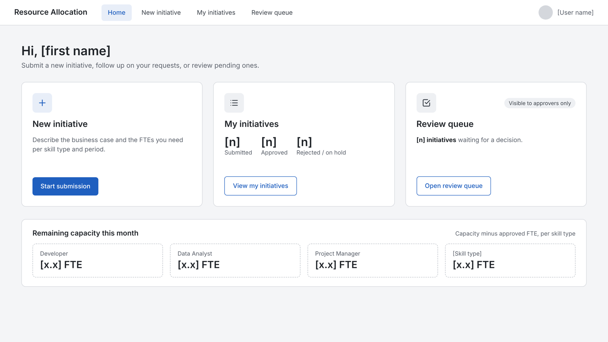
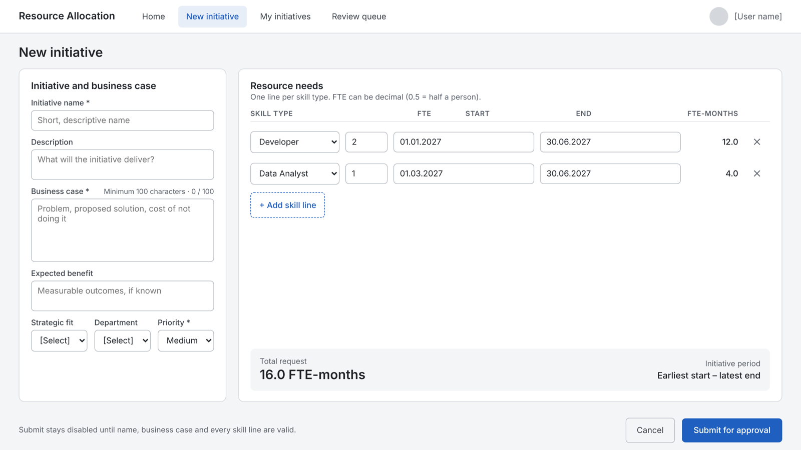
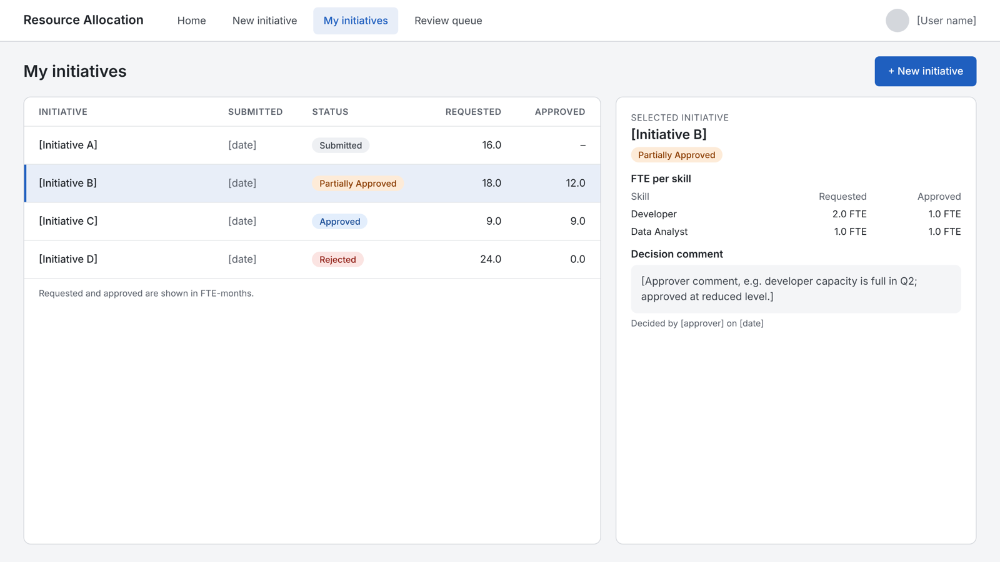
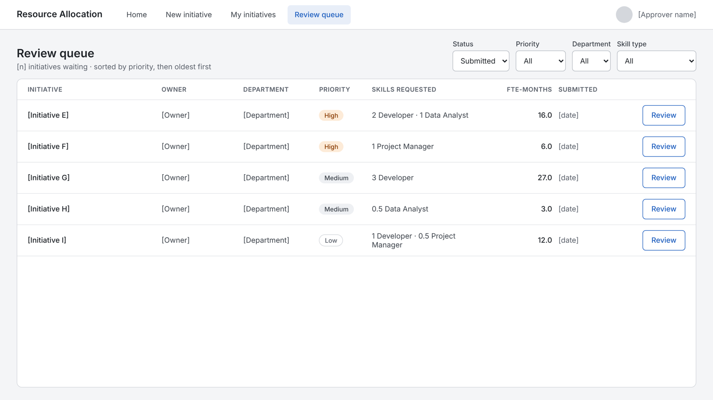
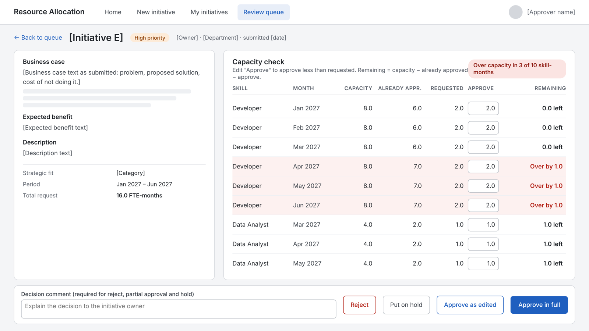

# Documentation

- **[Solution spec (PDF)](solution-spec.pdf)**: SharePoint data model, Power Apps screens and Power Fx, Power Automate flows, Power BI measures, pitfalls and open decisions.
- **[Wireframes (PDF)](wireframes.pdf)**: five Power Apps screens at tablet size (1366 × 768).
- **Live demo:** https://resource-allocation-hxwmj4n83x4aak4xy3coef.streamlit.app/

Bracketed names, dates and numbers in the wireframes are placeholders; capacity figures are sample values.

## Wireframes

### 1. Home

### 2. Submit initiative

### 3. My initiatives

### 4. Review queue

### 5. Review detail and capacity check

